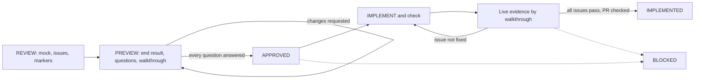

# UI Fix Loop



This loop owns the canvas: the mock, the issue list, and the markers.
`ui-verify-loop` continues the round after IMPLEMENTED.

## Shared rules

- Apply `ui-loop-core` §Glossary.
- Apply `ui-loop-core` §Size tiers T0–T2.
- Apply `ui-loop-core` §State machine and labels.
- Apply `ui-loop-core` §Dispatch.
- Apply `ui-loop-core` §Worktree and PR.
- Apply `ui-loop-core` §Evidence record.
- Apply `ui-loop-core` §Close-out.
- Apply `ui-loop-core` §Edit safety.

## The canvas

- Before you create the canvas path or add the approval widget, read `ui-loop-core/references/canvas-server.md`.
- Before you set the heading prefix or the card link, read `ui-loop-core/references/conductor.md`.
- Keep one canvas file for each issue. Update it in place through the phases. Do not make a copy for each phase.
- Write plain HTML/CSS that copies the related UI region. Do not use a framework or a build step.
- Put `data-task-id="<repo>/<slug>"` on the canvas root `<div class="wrap">`. Use the same value as the canvas path.
- Add this marker when you first build the canvas. It must exist before dispatch and in the frozen approved-reference snapshot.
- Reason: the dispatch binding freeze reads the task ID from this marker. A missing marker sets `binding.taskId` to null.
- Then `binding_freeze_present` fails, and the completion gate sets the whole run to BLOCKED.
- Example: run `canvas-e425e944f3c0` on 2026-10-13.

Before you serve or present the canvas, read `ui-loop-core/references/canvas-server.md`.

## Phase 1 — REVIEW

Build the REVIEW canvas before you read implementation code in depth.

1. Make a mock of the broken UI region as it renders now. Copy the defect exactly.
2. Write a numbered issue list. Give each defect one line with a concrete expected behavior.
3. Put one numbered marker on the mock for each issue.

**Done when:** each defect has a numbered issue and a matching marker, and the canvas opens in a browser.

## Phase 2 — PREVIEW

1. Show the intended end result of the same region on the same canvas.
2. Keep the issue list. Mark each issue "pending fix".
3. Apply `ui-loop-core` §Approval rules.
4. Write each open decision as a pill group. Use the canvas markup below.
5. Apply `ui-loop-core` §Element-access gate. Put the access-path diagram and the walkthrough on the canvas.
6. Show the canvas to the user. State the intended end result in one or two sentences.
7. Wait for APPROVED before you touch real code.

```html
<div class="approval-answer-select" data-question="① Topic — which report topic?">
  <div class="askTitle"><span>Topic</span><span>Single</span></div>
  <div class="askDesc">Which topic should the report cover?</div>
  <div class="askOptions">
    <button type="button" class="approval-option" data-option="Smart campus" data-recommended="true">Smart campus</button>
    <button type="button" class="approval-option" data-option="Company annual">Company annual</button>
  </div>
</div>
```

- Mark the recommended pill with `data-recommended="true"`. The widget adds the "(Recommended)" tag. Do not write it in the text.
- Leave all pills unselected.
- Use `<textarea class="approval-answer" data-question="⟨N⟩ <short question>">` only for a question without concrete options.

## Phase 3 — IMPLEMENT, then VERIFY

Before you select an executor, read `ui-loop-core/references/executor-triage.md`.

1. Implement the real fix in the project code.
2. Run the project checks: typecheck, tests, and build.
3. Load the live page. Record evidence for each numbered issue. If the element-access gate applies, follow the walkthrough step by step.
4. Update the canvas. Mark each issue fixed or still broken. Put the after rendering next to the original mock.
5. If an issue is not fixed on the live page, go back to step 1.
6. When every issue passes, open the PR. Write `IMPLEMENTED — PR <url> → <parent>`.

## Anti-patterns and pre-close checks

- Silence read as consent. An unanswered question is open. It does not select the default.
  Before you write APPROVED, confirm that each numbered question has an explicit answer.
- A blank textbox for a decision that has concrete options.
  Before you write APPROVED, confirm that each question with concrete options uses a pill group.
- A check of only the region the user named, when the change alters a shared predicate.
  Before you write IMPLEMENTED, confirm that each region that uses the changed predicate has live evidence.
- A "fixed" claim from code reading only.
  Before you write IMPLEMENTED, confirm that each issue has evidence from the live rendered page.
- An element that no one walked.
  Before you write IMPLEMENTED, confirm that the walkthrough existed before implementation and that the evidence followed it.
- Repeated patches of the same visual bug, each checked only against the symptom.
  Before you write IMPLEMENTED, confirm that the evidence covers each affected state, not only the reported one.
