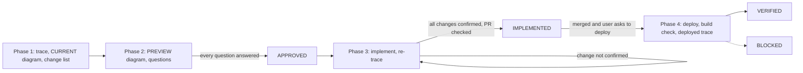

# UI Logic Loop

This loop owns the trace and the diagram pair.
A change that moves pixels and flow also uses `ui-fix-loop`. Each loop gates its own surface.

## Shared rules

- Apply `ui-loop-core` §Glossary.
- Apply `ui-loop-core` §Size tiers T0–T2.
- Apply `ui-loop-core` §State machine and labels.
- Apply `ui-loop-core` §Dispatch. For a combined round, use the canvas decision. Do not launch a second run.
- Apply `ui-loop-core` §Worktree and PR.
- Apply `ui-loop-core` §Evidence record.
- Apply `ui-loop-core` §Close-out.
- Apply `ui-loop-core` §Edit safety.

## The diagrams

- Use the `archify` skill: `sequence` for call chains, `architecture` for component shape, `lifecycle` for state machines.
- Path: `~/.agents/ui-logic-loop/<repo>/<issue-slug>-before.html` and `-after.html`, with `-before.sequence.json` and `-after.sequence.json`. `<repo>` is a lowercase-hyphen slug.
- CURRENT shows the traced flow. PREVIEW shows the intended end state. Do not edit a diagram after validation passes.
- Mark a redundant call with `variant: "dashed"` and a `note` that starts `REDUNDANT — <why + file:line>`.
- Mark a slow or large call with `variant: "emphasis"` and its measured number.
- Keep about 12 messages or fewer. Use a near-square viewBox, about 1040×540–850.

## Phase 1 — REVIEW

1. Trace the CURRENT flow: a browser network capture, a curl replay, or server logs. Code reading only adds to the trace.
2. Author the CURRENT diagram from the trace. Mark redundancies and costs.
3. Write a numbered change list. Give each change one line with a measurable expected effect, such as "×3 → ×1 `users/me`".
4. If UI actions are necessary to reach an element, apply `ui-loop-core` §Element-access gate. For a combined round, put the items on the shared canvas. For a diagram-only round, put them next to the diagram pair.

## Phase 2 — PREVIEW

1. Author the AFTER diagram of the intended end-state flow. Keep the numbered change list next to it.
2. Apply `ui-loop-core` §Approval rules. For a combined round, put the questions on the shared canvas. For a diagram-only round, ask in chat.
3. Show both diagrams. State the intended end state and the main metric.
4. When Phase 1 step 4 applies, include the access-path diagram and the walkthrough.
5. Wait for APPROVED before you touch real code.

## Phase 3 — IMPLEMENT, then VERIFY

1. Implement the real change in the project code.
2. Run the project checks: typecheck, tests, and build.
3. Trace the live flow again, as in Phase 1. Record the before and after metric for each numbered change. When Phase 1 step 4 applies, follow the walkthrough exactly.
4. Author the as-shipped diagram in a new file. Compare it with PREVIEW.
5. If a numbered change is not confirmed, go back to step 1.
6. When the diagram, the change list, and the trace agree, open the PR. Write `IMPLEMENTED — PR <url> → <parent>`.

## Phase 4 — DEPLOY and DEPLOYED TRACE

Start this phase only after the PR is merged and the user asks to deploy.

1. Ask the user for the deployment target. Deploy each changed deployable. State which deployable carries each numbered change.
2. Apply `ui-loop-core` §Environment pin and build check.
3. Trace again on the deployed environment, not on localhost. When Phase 1 step 4 applies, follow the same walkthrough.
4. Confirm each numbered metric. Write `VERIFIED — <env> <build-sha> <date>` with the before and after metric table.

## Anti-patterns and pre-close checks

- Silence read as consent.
  Before you write APPROVED, confirm that each numbered question has an explicit answer.
- A CURRENT diagram from code reading only.
  Before you write APPROVED, confirm that the CURRENT diagram comes from a live trace.
- A surface that no one walked.
  Before you write IMPLEMENTED, confirm that the walkthrough existed before implementation and that the trace followed it.
- An assumption that a client abort stops server work.
  Before you write IMPLEMENTED, confirm the server-side stop with a probe.
- A fix of the counted symptom while a shared consumer still uses the old path.
  Before you write IMPLEMENTED, confirm that each consumer of the changed code has trace evidence.
- A "fixed" claim from code review only.
  Before you write IMPLEMENTED, confirm that the live request waterfall shows each change.
- Local verification treated as shipped.
  Before you write VERIFIED, confirm the deployed trace and the build check.
