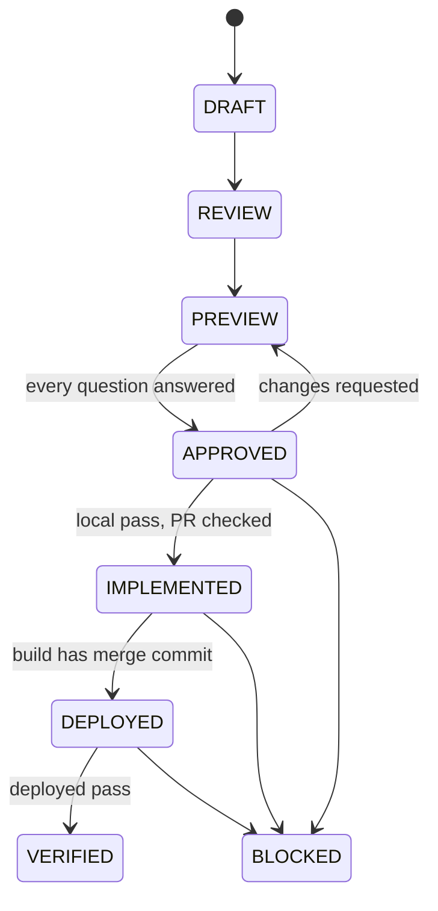

# UI Loop Core

Do not copy these rules into a loop skill.

## Glossary

Use one term for each concept.

- **Round**: one issue, from DRAFT to a closing label.
- **Run**: one dispatched coding-agent process in one round.
- **Canvas**: the one HTML file that records a round.
- **Reference**: the source of truth for the intended result.
- **Walkthrough**: the numbered list of UI actions that reaches an element.
- **Driver**: the tool that replays the walkthrough.
- **Evidence record**: the JSON file of results for a round.

## Size tiers T0–T2

Select one tier before you start. Record it.

- **T0**: a copy, constant, or style-token change on one surface, with no layout or flow change. Make no canvas. Run the checks and one live look.
- **T1**: the default. Do the full loop.
- **T2**: more than one role, surface, or deployable. Do the full loop. Write one walkthrough for each role.

If not sure, use the higher tier.

## State machine and labels

| State | Entry condition |
|---|---|
| REVIEW | The issue list or the current trace exists. |
| PREVIEW | The preview, numbered questions, and walkthrough exist. |
| APPROVED | Every numbered question has an explicit answer. |
| IMPLEMENTED | Local evidence is `pass` for every issue. PR refs are checked. |
| DEPLOYED | The user asked to deploy. The environment build contains the merge commit. |
| VERIFIED | Deployed evidence is `pass` for every issue. |
| BLOCKED | A gate cannot be met. |

Use only these closing labels:

- `IMPLEMENTED — PR <url> → <parent>`
- `VERIFIED — <env> <build-sha> <date>`
- `BLOCKED — <reason>`

Record the loop type in the evidence record, not in the label.

## Approval rules

Silence never approves.

1. Show each open decision as a numbered question with concrete options. Mark one option as recommended.
2. Use a free-text field only when no concrete options exist.
3. Do not ask about the deployment target, environment, or release timing.
4. Keep the approve action disabled until each question has an answer.
5. Accept a chat reply only if it names a choice for every numbered question.
6. If a reply is "approved" or leaves a question open, list the open numbers. Ask again and wait.
7. If the user requests changes, put the comment into the preview. Show it again.
8. Do not touch real code before APPROVED.

The steering input carries free direction. It does not replace an answer.

## Element-access gate

Use this gate when UI actions are necessary to reach an affected element. UI actions are clicks, route changes, and role or state prerequisites.

Before the approval gate, put two items on the canvas:

1. An access-path diagram from the app entry, through routes and clicks, to the element. Show each prerequisite as a branch. Use HTML/SVG or mermaid source.
2. A numbered walkthrough. Write one action on each line. Name the exact route or control on each line.

Example: `1. / 2. 登入 → /zh-Hant/login 3. /zh-Hant/dashboard 4. 學生訓練需要評估量表（側欄）5. 分頁 電郵發送追蹤 → 追蹤列的「立即發送／修改截止日期」`.

Local and deployed evidence follow the walkthrough step by step.
Do not change the steps between the runs. Reason: the results must be comparable.
If the round cannot reach an element on the recorded path, set it to BLOCKED before implementation.

**Driver.** Use ego-browser for T1 rounds.
Use Playwright for T2 rounds, with one isolated context for each role.
Record the driver, profile, account, and role of each replay.
Before the deployed replay, confirm that the page role matches the walkthrough role.
Reason: a shared ego-browser session can hide bugs.

Build the runnable walkthrough from `scripts/walkthrough.template.mjs`.
Run it with `--driver ego-browser` for T1 rounds.
Run it with `--driver playwright` for T2 or multi-role rounds.
Set `BASE_URL` for each environment.

## Dispatch

1. Offer the installed coding agents with the approval questions. Select Pi by default. Keep a saved explicit selection.
2. Save the selected agent in the decision record. Pass it to the dispatcher. A user choice overrides executor triage.
3. If the selected agent is not available, report the blocker and ask. Do not change the agent silently.
4. Start each run in its own uniquely named Herdr session, in the target repository directory.
5. Give a retry a new session. Do not launch duplicate runs on repeated approval.
6. Do not start an agent before APPROVED.
7. Show the agent, run ID, and Herdr session ID on the canvas.
8. Confirm the session and process exist before you report a started run.

Editing a skill does not deploy a runtime change. If the dispatcher cannot do these steps, report the gap.

## Worktree and PR

1. Run each approved implementation in a new git worktree and branch. Do not implement in the main checkout.
2. Cut the branch from the up-to-date parent branch. The default parent is `develop`. Do not ask to confirm it.
3. If the branch does not have the code, cut it again from the parent. Do not merge another branch into it.
4. Check the parent with `gh repo view`, `gh pr view`, and `gh api repos/<owner>/<repo>/branches/<parent>`. The GitHub default branch alone is not proof.
5. If the parent is not clear, add a final numbered question about it. Give your recommendation.
6. Create the PR with `gh pr create --base <parent> --head <worktree-branch>`.
7. Check both refs with `gh pr view <url> --json baseRefName,headRefName,url`. Correct a wrong base with `gh pr edit`.
8. Record the worktree path, branch, parent, and PR URL on the canvas.

## Environment pin and build check

Read machine facts in `references/canvas-server.md`, `references/conductor.md`, and `references/whiteboard.md`.
If you cannot read a `references/` file, write the gap on the canvas and ask the user. Do not guess its content.

Before the deployed replay:
1. Read the build identity from a version endpoint, image tag, or commit SHA.
2. Confirm the build contains the merge commit.
3. Record the environment and build SHA in the evidence record.

If you cannot read the build identity, set the round to BLOCKED.

## Evidence record

Keep one evidence record per round, next to the canvas: `<repo>/<issue-slug>.evidence.json`.
Use the schema in `references/evidence.schema.json`.

Each issue has a `local` result and a `deployed` result.

- Write IMPLEMENTED only when every `local.result` is `pass`.
- Write VERIFIED only when every `deployed.result` is `pass` and each `deployed.buildSha` contains `pr.mergeSha`.

Before you write IMPLEMENTED, run `node scripts/check-evidence.mjs --label implemented <record>` from the `ui-loop-core` folder.
Before you write VERIFIED, run `node scripts/check-evidence.mjs --label verified <record>`.
Write the label only on exit 0.

## Close-out

At round end, make two proposals:

1. **Memory note**: one fact that is not obvious, with its reason.
2. **Skill delta**: one proposed skill change.

If no fact qualifies as a memory note, write `Memory note: none` and one reason.
Always show both items.
Save neither without user approval.
Do not save logs, diffs, or facts the repository records.

## Edit safety

One agent edits a skill file at a time.

1. Before an edit, record the file SHA-256.
2. Before each write, check the SHA again.
3. If the SHA changed, stop. Report to the owner. Do not merge by guess.
4. Before you report a skill edit as done, run `node scripts/check-skill-text.mjs <file>`. Require exit 0.
