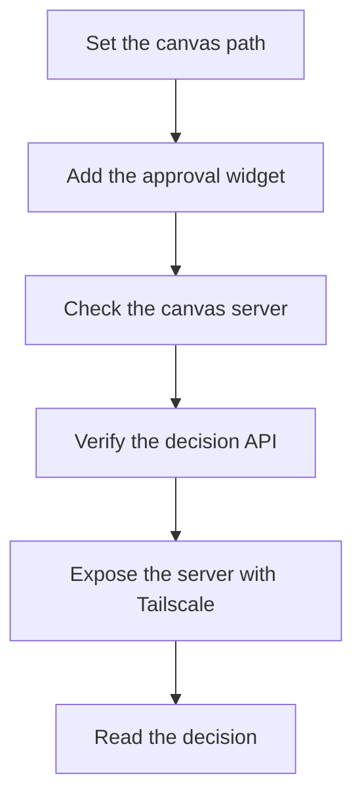

Source: ui-fix-loop/SKILL.md at backup ~/.agents/skill-backups/2026-10-13-structural-round-baseline/, moved 2026-10-13.

## The canvas

- Path: `~/.agents/ui-fix-canvas/<repo>/<issue-slug>.html` — outside every repo, so scratch files are never committed and no per-project setup is needed. The `<repo>` segment must be a lowercase-hyphen slug (`ai-leave-management-frontend`, never the GitHub-cased name) and, when the canvas should dispatch work, a key in the dispatch-watcher's `REPOS` map; root-level pages (`/<slug>.html`) are rejected too. A non-conforming segment makes every Approve POST 404 "unknown canvas" with no other symptom.
- Every canvas includes the approval widget: add `` before `</body>`. It renders a floating decision panel — per-question status, a **steering input** for the implementation logic, and Approve / Request-changes buttons that POST to the server's decision API. Open decisions come in two authoring forms (Phase 2): askUser-style **selection groups answered on the canvas itself** (`div.approval-answer-select[data-question]` with `button.approval-option` pills, the recommended one marked `data-recommended="true"`), and legacy free-text `approval-answer` fields the panel collects. The gate keys off both forms; the server-side question set/hash (`herdr_dispatch`) counts both too — a canvas with the script but no questions has a widget with nothing to gate.
- **Decision hooks.** Once a decision is saved, the widget dispatches a `ui-fix-loop:decision` CustomEvent on `document` (detail: `{canvas, status, comment, steering, answers, record}`) and calls `window.uiFixLoopApprovalCallback(record)` if defined — a canvas page can listen for either to chain behavior after `approved` (the callback must be set before the widget script loads). A non-2xx POST renders "save failed — is server.py running?" instead of a false success, and an exception thrown by the callback is logged after the fact without un-saving the decision.

## Serving the canvas (server.py + Tailscale)

- The canvas server normally runs under launchd (`com.kxxwxxg.canvas.server`, port 8791, localhost) — start `python3 ~/.agents/ui-fix-canvas/server.py` by hand only if it is down (a manual start while launchd holds the port just fails to bind). It extends a static server with a decision API: `POST /api/decision {canvas, status, comment}` writes `<repo>/<slug>.decision.json`; `GET /api/decision?canvas=...` reads it back (`status` is `pending` | `approved` | `changes-requested`). Do NOT use bare `python3 -m http.server` — it has no decision API.
- Before handing the URL to the user, prove the canvas is wired: `GET /api/decision?canvas=<repo>/<slug>` → `{"status":"pending"}`. That one request catches an unwired Approve button, a non-conforming repo segment, and a mistyped id — a 404 "unknown canvas" here means the widget would silently do nothing for the user too.
- Browsers in agent sessions can only open http(s) pages: open `http://localhost:8791/<repo>/<issue-slug>.html`. Screenshot it for the user when presenting.
- Expose the same server to the user's tailnet so they can review on any of their devices: `tailscale serve --bg 8791` → `https://<machine>.<tailnet>.ts.net/<repo>/<issue-slug>.html` (this machine: `mk1a3zpmacbook-pro.tail490654.ts.net`). If serve reports "not enabled on your tailnet", print the enable link it returns and ask the user to open it once, then run the serve command again.
- The agent learns the decision by reading the `.decision.json` file or GET-ing the API on localhost. A chat reply approving is equally valid — the widget is a convenience, not the only channel.
- Driving the dashboard API by curl (e.g. to check `/requirement-canvas/<cardId>`): `POST /login` wants a JSON body (`-H 'Content-Type: application/json' -d '{"token":"…"}'`, token in `~/.conductor/dashboard-token`) plus an `Origin` header — form-encoded bodies get 415. On the tailnet board URL (`:8443`) no token is needed: the tailnet identity authenticates.
