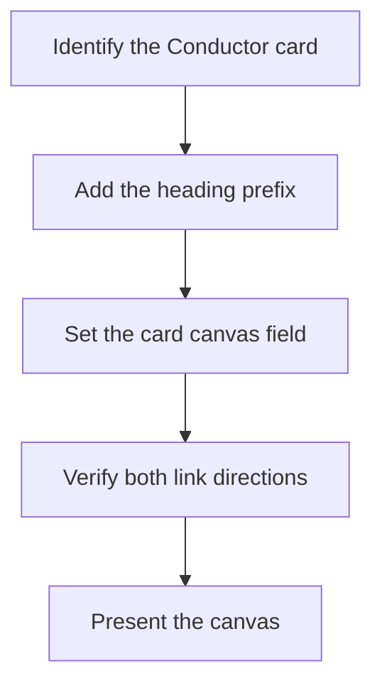

Source: ui-fix-loop/SKILL.md at backup ~/.agents/skill-backups/2026-10-13-structural-round-baseline/, moved 2026-10-13.

- **The heading carries the board task no.** When the work has a Conductor card — a canvas dispatch, or any request that can be tied to a card — begin both `<h1>` and `<title>` with `[t-<id8>]` (e.g. `<h1>[t-3ecb9f12] 前後測活動報告 …</h1>`), taken from the card's `display_id`. The raw `:8791` URL has no board chrome, so the heading is the only place the id can appear. When no card id is knowable, leave the heading clean rather than guessing — a wrong prefix is worse than none.
- **Traceability is two-way and is part of the deliverable:**
  - canvas → card: the `[t-<id8>]` heading above. A canvas opened from its bare tailnet URL is anonymous without it.
  - card → canvas: the card's `canvas` field must be `<repo>/<slug>` — that field is what the board card modal, the Inbox rows, and the `/requirement-canvas/<cardId>` board route render as the review link. Canvas dispatches write it at intake; for any other origin (interactive rounds, card created before/without the canvas), set it at canvas-creation time, not when the user goes looking for it. Setting it needs conductor tooling — `conductor.kanban_update` from a session that has it, or the dashboard card edit — so a session without conductor access must ask the conductor session to write the link rather than skip it.
  - Verify both directions before presenting: `GET /requirement-canvas/<cardId>` → 200 with `<title>t-<id8> · requirement canvas</title>`, and the served canvas `<title>` begins with `[t-<id8>]`. Query the tailnet board URL (the tailnet identity authenticates); on `localhost:8798` a session cookie is required or the GET redirects to `/login`. If either direction fails, the round is not reviewable end-to-end and must not be presented as ready.
