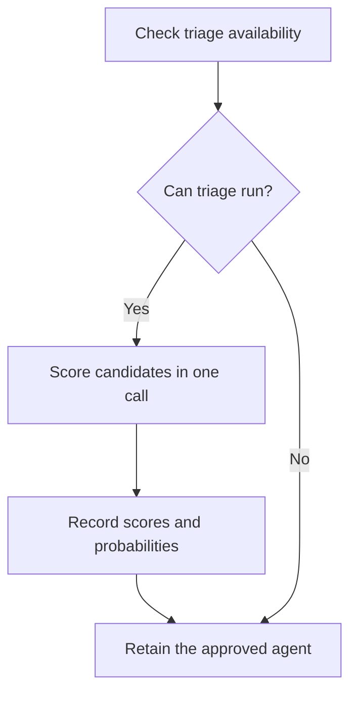

Source: ui-fix-loop/SKILL.md at backup ~/.agents/skill-backups/2026-10-13-structural-round-baseline/, moved 2026-10-13.

## Executor triage (optional — typesafe_evaluate)

When Phase 3 is about to start, more than one executor is available, and TypeSafe is enabled for the session (`/typesafe enable` once, or `PI_TYPESAFE_ENABLED=1` + `TYPESAFE_API_KEY` headless), spend **ONE** batched call to pick the dispatch target before implementing:

- **state**: the fix task in one sentence, plus one factual field per candidate agent — harness, model, browser tooling (can it drive the live-page evidence steps?), and its track record in this repo. Name the fields; the questions reference them.
- **questions**: one **score** question per agent — "How able is `candidates.<id>` to complete this task end to end?" on a 4-level rubric phrased as situations, not degrees (0 *unlikely: cannot drive the browser-verified loop unaided* / 1 *partial: lands the code but struggles with live-page evidence* / 2 *capable: completes fix + verification, maybe with a retry* / 3 *strong: end-to-end with evidence, minimal supervision*) — plus one **choice** question for dispatch order. One judgment per question; batch everything into the single request.
- **recommend** the highest score (break ties with the choice answer), and record the scores with their probabilities next to the canvas issue list or as a card event. Dispatch the approved agent under `ui-loop-core` §Dispatch; triage never silently overrides a user selection or the Pi default.

Guardrails: triage is an optimization, never a gate — if the tool is disabled, unkeyed, or returns a `budget` error, skip triage silently and retain the approved agent (Pi by default). Confidence is distribution concentration, not proof or authorization; report it alongside the choice, never act on it alone. Do not spend a second request re-triaging after a decline — the loop's own verify phase is the correction mechanism.
