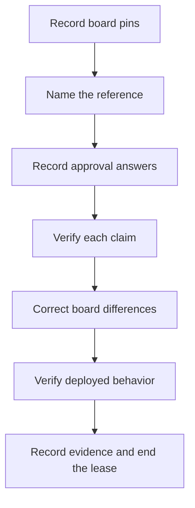

Source: ui-verify-loop/SKILL.md at backup ~/.agents/skill-backups/2026-10-13-structural-round-baseline/, moved 2026-10-13.

## Whiteboard-hosted rounds

When the evidence canvas is a Whiteboard board — typically produced by a similar prompt like **"produce the architecture-sketch Whiteboard (data flows, access patterns, code paths) and open it"** (whiteboard-agent-review Mode B) — run the same phases with these translations:

- **Canvas = a Whiteboard session.** Record the board's pins (`worktree`/`commits`, base, head) as Phase-0 provenance: they name the revision every `review-source:` link on the board resolves against.
- **Phase 0 carries over unchanged in substance** — reference naming, element-access recording (Phase 0 step 3, with the board as the recording surface when the sketch evidence is a Whiteboard), and approval stays explicit and numbered with required answers. For sketch-hosted rounds the realistic reference candidates are: a named environment's live behavior (strongest), the deployed branch the environment actually runs (e.g. up-to-date `develop`), or the board itself for pure-render rounds only. A sketch that cites code is **not** its own reference.
- **Cross-check = per-claim verification.** Read every linked range at the pinned revision with `git show <head>:<path>` in the board's pinned repository. Confirm each link points at the claimed text. Re-exercise the flows the board asserts against the reference environment. Write a per-claim `Verification` section on the board (claim → observed → agrees/differs), never a batch verdict.
- **Phase 1: fix the board, not the repo.** If the sketch drifted from reality, update the board under a fresh document lease (repin → read → edit). Only if the *reference itself* (env/artifact) turns out wrong or drifted is this a repo fix — and that becomes a new ui-fix-loop round with its own canvas.
- **Phase 2 unchanged.** Deployed-environment proof still means exercising the real user path on the named env; traceability URLs are recorded as board evidence. Close the board with the core label `VERIFIED — <env> <build-sha> <date>`. Use only the labels in `ui-loop-core` §State machine and labels. End the lease (`session_activity_end`) before `session_open` so the board reads as ready.
- **Evidence record.** Persist the whiteboard-agent-review JSON format with `agent: null` and `verification` entries pointing at the board's Verification section.
- **Authoring details, schemas, recovery.** See skill: whiteboard-agent-review (§Mode B — architecture-sketch whiteboard; §Schema notes learned on a live v0.2 run). Read `session_get_instructions` before authoring.
