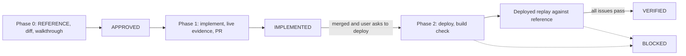

# UI Verify Loop

This loop owns the reference, the deploy, and the deployed proof.
`ui-fix-loop` proves that the change renders. This loop proves that the change is right and shipped.

## Shared rules

- Apply `ui-loop-core` §Glossary.
- Apply `ui-loop-core` §Size tiers T0–T2.
- Apply `ui-loop-core` §State machine and labels.
- Apply `ui-loop-core` §Dispatch. Reuse the approved decision of the fix or logic round. Do not dispatch a duplicate run.
- Apply `ui-loop-core` §Worktree and PR.
- Apply `ui-loop-core` §Evidence record.
- Apply `ui-loop-core` §Close-out.
- Apply `ui-loop-core` §Edit safety.

## Phase 0 — REFERENCE

Do these steps before you apply a fix.

1. Ask the user for the reference. Record it on the canvas. Valid references, strongest first:
   - an official artifact from the user, such as a template, a spec, a design export, or expected production data;
   - the approved canvas preview, for a visual-only round;
   - the live behavior of a named environment.
2. Compare the current state with the reference. Put the difference on the canvas, element by element. This difference defines the work.
3. If UI actions are necessary to reach an element, apply `ui-loop-core` §Element-access gate.
4. Apply `ui-loop-core` §Approval rules. The approval question must name the reference: "aligned to <file/env>, approve?"

## Phase 1 — IMPLEMENT and LIVE VERIFY

1. Apply `ui-fix-loop` Phase 3. When Phase 0 step 3 applies, follow the walkthrough step by step for the live evidence.
2. Open the PR into the confirmed parent branch.
3. Write `IMPLEMENTED — PR <url> → <parent>`. Stop there.

Do not ask about deployment before or during implementation.

## Phase 2 — DEPLOY and DEPLOYED PROOF

Start this phase only after the PR is merged and the user asks to deploy.

1. Ask the user for the deployment target. Deploy the change there. If the frontend and the backend both changed, deploy both.
2. Apply `ui-loop-core` §Environment pin and build check.
3. Do the reference comparison again on the deployed environment, not on localhost. Use the real user path.
4. When Phase 0 step 3 applies, follow the same walkthrough step by step.
5. Record the deployed evidence for each numbered issue. Localhost evidence does not count here.
6. If the round has a Conductor card, read `ui-loop-core/references/conductor.md`. Confirm both link directions. Record the two URLs and results.
7. When the evidence and the deployed environment agree, write `VERIFIED — <env> <build-sha> <date>`. Show the screenshots inline.

A round with no known card ID does not do step 6.

## Whiteboard-hosted rounds

Before you run a round whose canvas is a Whiteboard board, read `ui-loop-core/references/whiteboard.md`.

## Anti-patterns and pre-close checks

- A pass on localhost while the deployed environment runs an old build.
  Before you write VERIFIED, confirm that the deployed build contains the merge commit.
- A check by code reading or API status codes, not by the real artifact path.
  Before you write VERIFIED, confirm that each issue has evidence from the real user path on the deployed environment.
- A fix toward an assumed reference. The user-named artifact is the only reference. Report drift. Do not normalize it silently.
  Before you write APPROVED, confirm that the user named the reference.
- No reference or approval question, because the fix looks obvious.
  Before you write APPROVED, confirm that the approval question names the reference.
- An element that no one walked.
  Before you write VERIFIED, confirm that the local and deployed evidence followed the same walkthrough.
- Code citations on a Whiteboard sketch used as verification. A citation is provenance, not proof.
  Before you write VERIFIED, confirm that each sketch claim has deployed-environment evidence.
