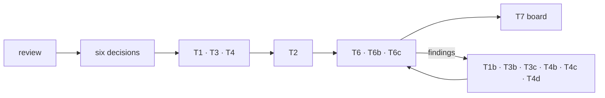

# ui-loop-skills-audit

Audit trail for the 2026-10-13 rework of the `ui-fix-loop`, `ui-verify-loop`, and `ui-logic-loop` skills.

## Layout

| Path | Content |
|---|---|
| `.agents/skills/` | Verified skill snapshot: `ui-loop-core` (new), the three thinned loops, references, scripts. Commit history shows each step. |
| `round-record/2026-10-13-ui-loop-skills-review.md` | The review (findings F1–F16, proposed structure, STE rules). |
| `round-record/2026-10-13-structural-round-orchestration.md` | The multi-agent plan, status log, and close (§10–§12). |
| `round-record/structural-round/` | Task specs (T1–T7), verifier reports, baseline and final SHA-256. |

## Source of truth

The live skills are in `~/.agents/skills` and publish to `kimwoct/skills`. This repo is a record. Do not edit skills here.

Whiteboard board `80954030` is pinned to commit `457e4f2` of this history.
