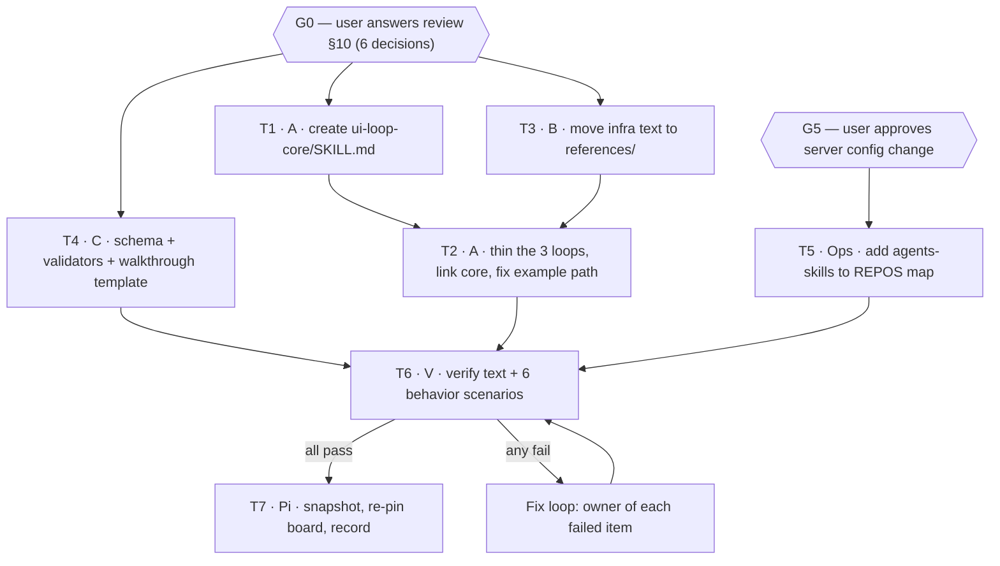

# Structural round: multi-agent orchestration plan

Author: Claude (Opus), as reviewer and coordinator. This file is a plan. It changes nothing.
Date: 2026-10-13.
Inputs:
- Review: `~/.agents/skill-reviews/2026-10-13-ui-loop-skills-review.md` (F1–F16, §4–§10).
- Close-out of the element-gate round (board `80954030` v27, snapshot `ee9e944`).
- Orca orchestration guide, loaded from the installed binary (`orca skills get orchestration`).

Language: the task specs in §6 use the STE writing rules from review §7.

---

## 1. Lessons from today, used as design input

Each rule in this plan comes from a failure or a success observed today.

| # | Observation (evidence) | Rule in this plan |
|---|---|---|
| L1 | Two agents edited the same skills at the same time. One deleted the other's board and snapshot. | One writer per file set. A SHA check before each write. (§3) |
| L2 | `orca terminal send` returned `accepted: true`, but Pi's session file did not change. The prompt was lost. | Use `orca orchestration` messages and `worker_done`, not raw terminal input. Proof of receipt is a session change, not `accepted`. |
| L3 | Multi-line text pasted into a TUI can submit early or disappear. | Put the task in a file. Send a one-line prompt that names the file. |
| L4 | The reviewer, not the writer, found the real defects: the L37/L46 condition, the stale L69 anchor, the missing blocker in round 1. | The verifier is a different agent from the writer. (§2) |
| L5 | Grep checks passed while behavior failed (round-1 demo: reachability FAIL). | Each task has a behavior check, not only text checks. |
| L6 | The skill example used 量表追蹤. The app has no such label. | Examples come from a walked path, with the evidence file named. |
| L7 | Decisions answered in chat worked. The canvas Approve button failed (`invalid_repository`). | Decision gates run in Orca (`gate-create`) or chat until T5 fixes the REPOS map. |

---

## 2. Roles

| Role | Who | Can edit | Cannot do |
|---|---|---|---|
| User | you | everything | — |
| Coordinator | Claude (this session) | this plan, gate records | edit skill files (Orca review-ownership rule: a review result authorizes synthesis, not coordinator edits) |
| Writer A — skills | one agent | `~/.agents/skills/ui-loop-core/SKILL.md`, the three loop `SKILL.md` files | edit references or scripts owned by B or C |
| Writer B — references | one agent | `ui-loop-core/references/*.md` | edit any `SKILL.md` |
| Writer C — tooling | one agent | `ui-loop-core/references/evidence.schema.json`, `ui-loop-core/scripts/*` | edit any `.md` |
| Ops — canvas server | one agent, after your approval | canvas server / dispatch-watcher config only | edit skills |
| Verifier V | a different agent from A, B, C | nothing (review-only) | fix what it finds; it reports, the owner fixes |
| Board owner | Pi (omp) | snapshot repo, board `80954030` | edit skill files |

Agent support limit (checked today): `orca orchestration worker-start --agent` accepts
`claude, codex, cursor, antigravity, muse, zcode, opencode, opencode2`. It does not list
`omp` or `pi`. So Pi cannot be a supervised worker started by Orca. Two options:

1. Pi keeps the board-owner role as an **unsupervised handoff** (file + one-line prompt, as today).
2. Test `worker-start --task <id> --terminal <pi-handle> --worktree current` once on a no-op
   task. Use Pi as a supervised worker only if that test returns a valid `worker_done`.

Suggested assignment (change it freely):

| Role | Agent | Reason |
|---|---|---|
| Writer A | claude (opus) | Long controlled-language prose; one writer for all skill text (L1). |
| Writer B | codex | Mechanical move of existing text into reference files. |
| Writer C | codex | JSON schema, validator script, browser-driver template. |
| Ops | codex | Small config change, high blast radius → separate owner. |
| Verifier V | claude (sonnet) **or** Pi | Must not be Writer A's agent and model. Pi has browser tooling (chrome-devtools MCP) and passed the A/B behavior checks today. |
| Board owner | Pi | Owns board `80954030` and its snapshot already. |

---

## 3. File ownership map

No two tasks write the same path. The coordinator rejects a task spec that breaks this.

```text
~/.agents/skills/
  ui-loop-core/SKILL.md                      A (T1)
  ui-loop-core/references/canvas-server.md   B (T3)
  ui-loop-core/references/conductor.md       B (T3)
  ui-loop-core/references/executor-triage.md B (T3)
  ui-loop-core/references/whiteboard.md      B (T3)
  ui-loop-core/references/evidence.schema.json   C (T4)
  ui-loop-core/scripts/check-evidence.mjs        C (T4)
  ui-loop-core/scripts/check-skill-text.mjs      C (T4)
  ui-loop-core/scripts/walkthrough.template.mjs  C (T4)
  ui-fix-loop/SKILL.md                       A (T2)
  ui-verify-loop/SKILL.md                    A (T2)
  ui-logic-loop/SKILL.md                     A (T2)
~/.agents/ui-fix-canvas/ (server + watcher config)   Ops (T5)
~/.whiteboard-skills-snapshots/... + board 80954030  Pi (T7)
```

Edit guard for every writer: record SHA-256 of each owned file before the task. Before
each write, compare. If a file changed, stop and send `ask` to the coordinator.

---

## 4. Task graph



- Wave 1 (parallel, after G0): T1, T3, T4. Disjoint files.
- Wave 2: T2 (needs T1 for link targets, T3 so removed text has a new home).
- Wave 3: T6 (needs T2, T4, T5). Then T7.
- T5 is independent of the skill text. It needs only gate G5.
- Depth is 3 steps. The Orca guide asks for waves over chains deeper than 3–4.

Separate track, not in this Run: the PR for
`documentation/survey-email-signature-contact-tutor.md` in the JCKAK repo. Different repo,
different owner. Start it when you choose.

---

## 5. Gates

### G0 — six decisions (review §10)

Create one gate per decision on the T1 task, or answer them in chat. Recommended answers
are marked. Writers start only after all six have an explicit answer.

| # | Decision | Recommended |
|---|---|---|
| 1 | New `ui-loop-core` skill, or shared section in `ui-fix-loop`? | New `ui-loop-core` |
| 2 | Walkthrough driver | ego-browser for T1 rounds, Playwright for T2 / multi-role |
| 3 | STE scope | All skill text |
| 4 | Skill deltas at close-out | Allowed, with your approval |
| 5 | Graph first | Every canvas, board, and handoff starts with a text-form graph |
| 6 | Who implements | The assignment in §2 |

### G5 — server config

T5 changes a running service that every canvas uses. It needs your explicit approval
before dispatch, and a rollback line in the spec.

---

## 6. Task specs (Orca task-spec contract: Target, Change, Constraints, Ownership, Acceptance)

Each spec is a file. The worker gets a one-line prompt that names its file (L3).
Write them to `~/.agents/skill-reviews/structural-round/T<n>.md`.

### T1 — create `ui-loop-core` (Writer A)

- **Target:** `~/.agents/skills/ui-loop-core/SKILL.md` (new).
- **Change:** Write the sections in review §4, in this order: glossary, tiers T0–T2,
  state machine and labels, approval rules, element-access gate, dispatch, worktree and PR,
  environment pin and build check, evidence record, close-out, edit safety.
  - Move the element-access gate from `ui-fix-loop` L90–98 into core. Keep its meaning.
  - Use the walked example path (L6):
    `1. /zh-Hant/dashboard 2. Toggle Sidebar 3. 學生訓練需要評估量表 4. 電郵發送追蹤 tab 5. table row → 立即發送`.
    Role: school admin. Source: `~/.agents/ui-fix-canvas/behavior-check-a/canvas.html`.
  - Start the file with one mermaid graph of the state machine (decision 5).
- **Constraints:** STE rules in review §7. Max 25 words per sentence. Max 1,200 words.
  No machine-specific values (ports, host names, token paths): those belong to T3.
- **Ownership:** this one file only.
- **Acceptance:** `check-skill-text.mjs` (from T4) reports 0 sentences over 25 words and
  ≤ 1,200 words. Every section in the list exists as a heading.

### T2 — thin the three loops (Writer A)

- **Target:** `ui-fix-loop/SKILL.md`, `ui-verify-loop/SKILL.md`, `ui-logic-loop/SKILL.md`.
- **Change:** Replace each shared contract with one line that links its core section.
  Keep only the loop's own surface (pixels, flow, reference/deploy). Delete the text that
  T3 moved; add "Read `ui-loop-core/references/<file>.md` before <action>."
  Replace the 量表追蹤 example everywhere with the T1 example.
- **Constraints:** STE. Max 700 words per file. Keep all anti-pattern entries, each
  restated as a pre-close check (F14).
- **Ownership:** these three files only.
- **Acceptance:**
  - `grep -c 量表追蹤` = 0 in all skills.
  - `grep -l "Herdr session"` lists only `ui-loop-core/SKILL.md`.
  - `grep -c 8791 ui-fix-loop/SKILL.md` = 0.
  - Each file ≤ 700 words. Every link to core names a heading that exists.

### T3 — move infra text to references (Writer B)

- **Target:** the four `references/*.md` files in §3.
- **Change:** Copy, do not paraphrase, the source ranges: canvas server
  (`ui-fix-loop` "Serving the canvas"), conductor traceability, executor triage,
  Whiteboard-hosted rounds. Add a one-line header naming the source file and the
  snapshot commit `ee9e944`.
- **Constraints:** Do not edit any `SKILL.md`. T2 deletes the source text.
- **Ownership:** the four reference files.
- **Acceptance:** each moved range is present byte-for-byte (diff against `ee9e944`).

### T4 — evidence and tooling (Writer C)

- **Target:** schema and three scripts in §3.
- **Change:**
  - `evidence.schema.json`: review §6, plus `driver` and `profileOrAccount` fields.
  - `check-evidence.mjs`: exit 1 unless every issue has `deployed.result = pass` and the
    deployed build SHA contains `pr.mergeSha` (F4, F6).
  - `check-skill-text.mjs`: word count, sentences over 25 words, missing link targets.
  - `walkthrough.template.mjs`: one step list, two drivers (ego-browser, Playwright),
    `BASE_URL` parameter, one screenshot per step.
- **Constraints:** Node ESM, no new global installs.
- **Ownership:** the four files.
- **Acceptance:** the schema validates the review §6 example. `check-evidence.mjs` passes a
  good fixture and fails two bad ones (missing deployed result, SHA mismatch). The template
  runs the walked example path on localhost with ego-browser.

### T5 — REPOS map (Ops, after G5)

- **Target:** the canvas server / dispatch-watcher `REPOS` map.
- **Change:** add `agents-skills` with working directory `~/.agents`.
- **Constraints:** Back up the config first. Write the rollback command in the report.
  Restart through launchd (`com.kxxwxxg.canvas.server`), not by hand.
- **Ownership:** that config only.
- **Acceptance:** `POST /api/decision` for `agents-skills/element-gate-skill-sync` returns
  success, and `GET` reads the saved status back. Existing repos still return 200.

### T6 — verify (Verifier V, review-only)

- **Target:** the outputs of T1–T5.
- **Change:** none. Report findings only.
- **Checks:**
  1. All acceptance checks of T1–T5, run again by V.
  2. The six behavior scenarios in review §9, each in a fresh session that loads only
     the new skills. Add scenario 7: a deployed replay where the build SHA does not
     contain the merge commit → the agent does not write VERIFIED.
- **Ownership:** none. V writes only its report file.
- **Acceptance:** report lists each check with pass/fail and the evidence path.
  On any fail, the coordinator routes the item to its owner (§3), then reruns T6.

### T7 — board and snapshot (Pi)

- **Target:** snapshot repo and board `80954030`.
- **Change:** copy all skill files incl. `ui-loop-core/**`, commit, re-pin, rewrite
  anchors, add the T6 results. Start the board with the §4 graph.
- **Acceptance:** 0 broken anchors (sweep script), board opened with lease ended.

---

## 7. Coordinator runbook (commands from the installed Orca guide)

Run these in the coordinator's Orca terminal. `orca` is the resolved executable.

```text
orca status --json
orca orchestration run-create --objective "ui-loop skills structural round" --json

# Wave 1 (after G0 answers)
orca orchestration task-create --spec "Read ~/.agents/skill-reviews/structural-round/T1.md and do it." --json   # → T1 id
orca orchestration task-create --spec "Read …/T3.md and do it." --json                                      # → T3 id
orca orchestration task-create --spec "Read …/T4.md and do it." --json                                      # → T4 id
orca orchestration task-create --spec "Read …/T2.md and do it." --deps '["<T1>","<T3>"]' --json
orca orchestration task-create --spec "Read …/T6.md and do it." --deps '["<T2>","<T4>","<T5>"]' --json

orca orchestration worker-start --task <T1> --worktree current --agent claude --model opus --json
orca orchestration worker-start --task <T3> --worktree current --agent codex --json
orca orchestration worker-start --task <T4> --worktree current --agent codex --json

# Wait loop
orca orchestration check --wait --types "worker_done,escalation,question" --timeout-ms 900000 --json
orca orchestration reply --id <message_id> --body "<answer>" --json
orca orchestration worker-release --dispatch <dispatch_id> --json      # after an accepted worker_done
orca orchestration check --ack <delivery_id> --wait --types "worker_done,escalation,question" --timeout-ms 900000 --json
```

Coordinator rules (from the guide, applied here):

- A timeout or empty `check` is a checkpoint. After three empty waits, run
  `orca orchestration worker-list --json` and act only on its `nextAction`.
- Reuse Writer A's terminal for T2 after T1 settles:
  `worker-start --task <T2> --terminal <A-handle> --worktree current`.
- A review-only `worker_done` from V authorizes routing, not coordinator edits.
- Before the turn ends: `worker-list --terminal-state reclaimable` returns none.

`worktree current` note: `~/.agents` is not a Git repository. Orca accepts folder
workspaces, but confirm with a no-op task before wave 1 that `--worktree current` resolves
when the coordinator sits in the JCKAK checkout. If it resolves to JCKAK, pass the folder
selector for `~/.agents` instead (see `references/placement-and-remote.md`).

---

## 8. Communication standard between agents

1. **Graph first.** Every task file and every report starts with a mermaid graph of the
   part it changes.
2. **STE.** Imperative, one instruction per sentence, max 25 words, one term per concept.
3. **Files carry content; prompts carry pointers.** One-line prompts name a file (L3).
4. **Proof over status.** "accepted", "queued", or "dispatched" is not proof. Proof is a
   `worker_done` with `--outcome`, a file SHA, a command output, or a screenshot path.
5. **Ask, do not guess.** A worker blocked by a changed SHA, a missing heading, or an
   unclear decision sends `ask`. It does not continue on an assumption.

---

## 9. Before you start: three checks

1. Answer G0 (six decisions).
2. Approve or refuse G5 (REPOS map change).
3. Confirm the agent assignment in §2, especially the verifier (must differ from Writer A).

After that, the coordinator writes the seven task files and starts wave 1.

---

## 10. Status update — 2026-10-13, after G0

**G0 answered by the user:** decisions 1–5 as recommended; decision 6 = this plan's §2
(Claude Opus writes T1–T2, codex writes T3–T4, a different agent verifies T6, Pi owns T7,
Pi does not edit skill files). **G5 (REPOS map) is NOT approved.** T5 is out of this run,
and T6 no longer depends on T5.

**Verifier:** opencode (installed; neither Claude nor codex).

**Task files:** `~/.agents/skill-reviews/structural-round/` — `COMMON.md`, `T1.md`, `T2.md`,
`T3.md`, `T4.md`, `T6.md`, `baseline.sha256`. Backup:
`~/.agents/skill-backups/2026-10-13-structural-round-baseline/`.

**New facts found during preflight:**

1. **Baseline moved.** Pi edited `ui-fix-loop` at 12:55 (example walkthrough → real app path,
   snapshot commit `5945b19`). That change is in scope and kept. Baseline SHA-256:
   `ui-fix-loop 546c4cc1…`, `ui-verify-loop 3c043c95…`, `ui-logic-loop 807ecc36…`.
2. **05:00 publish deadline.** launchd job `com.kimwoct.skill-sync` runs
   `~/Documents/GitHub/skills-kimwoct/scripts/daily-skill-sync.sh` daily at 05:00. It rsyncs
   `~/.agents/skills` → the repo, commits, runs an AI review, and pushes to
   `github.com/kimwoct/skills`. A half-finished round at 05:00 gets published. Finish before
   05:00, or pause the job for one night (`launchctl bootout gui/$(id -u)/com.kimwoct.skill-sync`,
   then `launchctl bootstrap gui/$(id -u) ~/Library/LaunchAgents/com.kimwoct.skill-sync.plist`).
3. **Placement.** `~/.agents` is not an Orca workspace. Workers started with
   `--worktree current` from the JCKAK terminal get the JCKAK folder as cwd. Codex
   (workspace-write sandbox) and Claude (permission prompts) may then be unable to write to
   `~/.agents/skills` without blocking. Fix: register `~/.agents` as an Orca folder
   workspace (`orca project setup-existing-folder … --kind folder --path /Users/user/.agents`)
   and start workers with `--worktree id:<returned id>`. This changes Orca's project
   configuration, so it needs the user's approval.
4. **Pi** is not a supported `worker-start` agent. T7 stays a handoff (file + one-line prompt).

## 11. Status — implementation complete, verification running

- T1, T2, T3, T3b, T4, T4b accepted by the coordinator after re-running each acceptance check. T6 (opencode, `ctx_540e5f55b661`) running.
- User decision: Pi does not implement the six decisions; this run already did. Pi's form answers are recorded only.
- User decision: keep Pi's 12:59 change (`agents-skills` in `decisionOnlyRepositories`, `~/.agents/ui-fix-canvas/dispatch-config.json`). Not reverted. T5 is closed by that change for decision saving only; full REPOS dispatch stays unapproved.
- Pi's next task: T7 (snapshot + board) after T6 passes.

## 12. Close — 2026-10-13

- Final: snapshot `457e4f2`, board `80954030` v64 pinned to it, 21/21 anchors resolve. Live skills match `final.sha256` (5 entries OK).
- Accepted tasks: T1, T1b, T2, T3, T3b, T3c, T4, T4b, T4c, T4d, T6, T6b, T7. Behavior S1–S7 pass.
- 05:00 sync job reloaded; it publishes the verified set.
- Open, outside the run: T6 opencode worker `ctx_540e5f55b661` stuck at its 5-hour usage limit after writing its report; it never sent worker_done. Not stopped by the coordinator (no proof of exit). The user may close its terminal.
- Parked: PR for `documentation/survey-email-signature-contact-tutor.md`.
