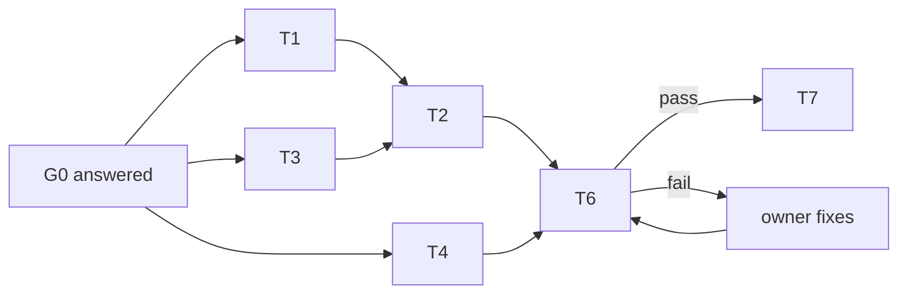

# Common rules for every task in this round

1. Read your task file first. Do only that task.
2. Edit only the paths your task file lists under Ownership.
3. Before your first write, compare each owned file with `baseline.sha256` in this folder. A new file has no baseline.
4. Before each write, check the SHA again. If it changed, stop. Send an `ask` to the coordinator. Do not merge by guess.
5. Write in STE: imperative, one instruction per sentence, max 25 words, one term per concept. Keep tool names and paths unchanged.
6. Start each new document with a mermaid graph of what it describes.
7. Do not edit any file in `~/Documents/GitHub/skills-kimwoct`. A sync job copies `~/.agents/skills` there at 05:00.
8. When done, send `worker_done` once, with `--outcome succeeded` or `--outcome failed`, and `--files-modified`.

Decisions (G0, answered by the user 2026-10-13):
1. New `ui-loop-core` skill. 2. Replay driver: ego-browser for T1 rounds, Playwright for T2/multi-role.
3. STE for all skill text. 4. Close-out may propose skill edits; the user approves each.
5. Graph first everywhere. 6. Writers: Claude Opus (T1, T2), codex (T3, T4); verifier opencode (T6); Pi (T7).

Plan: `~/.agents/skill-reviews/2026-10-13-structural-round-orchestration.md`.
Review: `~/.agents/skill-reviews/2026-10-13-ui-loop-skills-review.md`.
