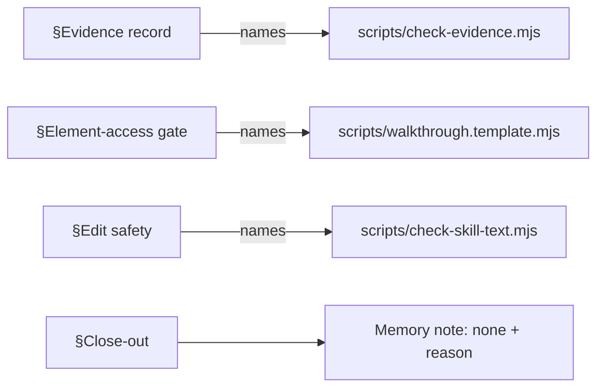

# T1b — connect core to the T4 scripts (Writer A: Claude Opus)

Read `COMMON.md` first. T6b (behavior test) found that no skill names the scripts T4 built.

- **Target:** `~/.agents/skills/ui-loop-core/SKILL.md` only.
- **Change (four additions, STE):**
  1. §Evidence record: replace "Check the record with a script, not by reading." with an instruction to run `node scripts/check-evidence.mjs <record>` from the `ui-loop-core` folder before writing IMPLEMENTED or VERIFIED, and to write the label only on exit 0.
  2. §Element-access gate: tell the agent to build the runnable walkthrough from `scripts/walkthrough.template.mjs`, with `--driver ego-browser` for T1 rounds and `--driver playwright` for T2 or multi-role rounds, and `BASE_URL` set per environment.
  3. §Edit safety: before a skill edit is proposed as done, run `node scripts/check-skill-text.mjs <file>` and require exit 0.
  4. §Close-out: if no fact qualifies as a memory note, write "Memory note: none" and one reason. Always show both items.
  5. One sentence in the most fitting section: if a `references/` file cannot be read, write the gap on the canvas and ask the user. Do not guess its content.
- **Constraints:** STE, max 25 words per sentence, core stays ≤ 1,200 words. Do not change other sections.
- **Ownership:** this one file. Baseline hash is in `baseline.sha256`.
- **Acceptance:** `grep -c` finds `check-evidence.mjs`, `walkthrough.template.mjs`, `check-skill-text.mjs`, and `Memory note: none` (≥1 each); `node ~/.agents/skills/ui-loop-core/scripts/check-skill-text.mjs` on the core exits 0.
