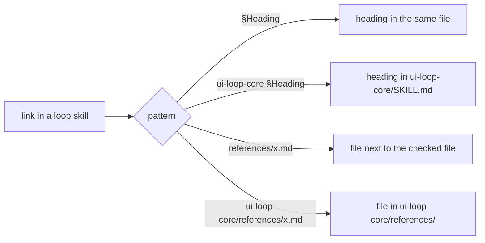

# T4b — make check-skill-text.mjs resolve cross-skill links (Writer: codex)

Read `COMMON.md` first.

- **Target:** `~/.agents/skills/ui-loop-core/scripts/check-skill-text.mjs` and new fixtures in `scripts/fixtures/`.
- **Change:**
  1. Resolve `ui-loop-core §<Heading>` (with or without backticks around `ui-loop-core`) against the headings of `<skills-root>/ui-loop-core/SKILL.md`.
  2. Resolve `ui-loop-core/references/<file>.md` against `<skills-root>/ui-loop-core/references/`.
  3. `<skills-root>` is the parent of the checked file's skill folder.
  4. Keep the current rules for same-file `§<Heading>` and plain `references/<file>.md`.
- **Constraints:** Do not edit any `SKILL.md` or reference file. Node ESM. No installs.
- **Ownership:** `check-skill-text.mjs` and the new fixtures only. Its baseline hash is in `baseline.sha256`.
- **Acceptance:**
  - A fixture loop skill with `Apply \`ui-loop-core\` §Approval rules.` and `ui-loop-core/references/canvas-server.md` reports 0 missing link targets.
  - A fixture with `ui-loop-core §No Such Heading` and `ui-loop-core/references/missing.md` reports 2 missing link targets and exits 1.
  - The existing good/bad text fixtures give the same result as before.
