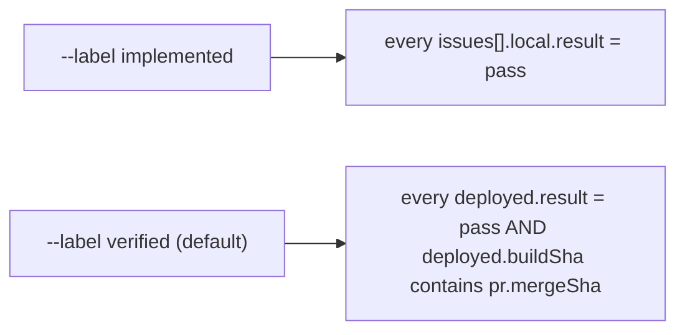

# T4c — check-evidence.mjs supports both labels (Writer C: codex)

Read `COMMON.md` first.

- **Target:** `~/.agents/skills/ui-loop-core/scripts/check-evidence.mjs` and `scripts/fixtures/`.
- **Change:** add `--label implemented|verified`. Default is `verified`, so the current behavior stays the same without the flag. `implemented` exits 1 unless every `issues[].local.result` is `pass`, and prints each failing issue. Update `--help` / usage text.
- **Constraints:** Node ESM. Do not edit any `.md`. Baseline hash is in `baseline.sha256`.
- **Ownership:** the script and fixtures only.
- **Acceptance:**
  - `--label implemented fixtures/implemented.json` → exit 0.
  - `--label verified fixtures/implemented.json` → exit 1.
  - Add a fixture with one `local.result` = `fail`: `--label implemented` → exit 1.
  - The three existing fixtures give the same results as before without the flag.
