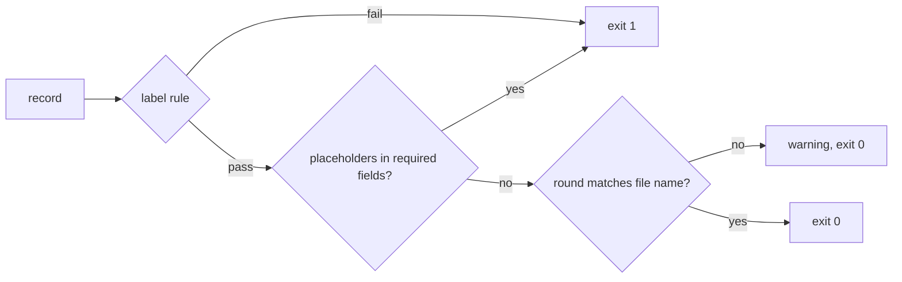

# T4d — check-evidence.mjs rejects placeholders (Writer C: codex)

Read `COMMON.md` first. Approved by the user (decision 4 proposal from scenario S6).

- **Target:** `~/.agents/skills/ui-loop-core/scripts/check-evidence.mjs` and `scripts/fixtures/`.
- **Change:**
  1. Both labels: exit 1 when a required field is a placeholder. Placeholder = empty string, `"..."`, `"…"`, `"TODO"`, `"<...>"`-style angle text, or `null` where a value is required.
  2. Required for `--label implemented`: `round`, `reference.value`, `pr.url`, `pr.head`, `pr.base`, each `issues[].expected`, each `issues[].local.result`, each `issues[].local.artifact`.
  3. Required for `--label verified`: everything above, plus `pr.mergeSha`, each `issues[].deployed.env`, `.buildSha`, `.artifact`.
  4. `dispatch.*` is optional (direct rounds have no run). If present, it must not be a placeholder.
  5. Print a warning (exit unchanged) when the `round` slug's last segment does not equal the evidence file name without `.evidence.json`.
  6. Print each failing field path.
  7. Update `good.json` and `implemented.json` with realistic non-placeholder values so they keep their current label results. Add `placeholder-pr-url.json` (exit 1 for both labels) and `round-mismatch.json` (exit 0 with a warning).
- **Constraints:** Node ESM. Do not edit any `.md`. Baselines in `baseline.sha256`.
- **Ownership:** the script and fixtures only.
- **Acceptance:**
  - `good.json`: verified → 0. `implemented.json`: implemented → 0, verified → 1. `local-fail.json`: implemented → 1.
  - `missing-deployed-result.json`, `sha-mismatch.json`: verified → 1 (unchanged).
  - `placeholder-pr-url.json`: both labels → 1, and the output names `pr.url`.
  - `round-mismatch.json`: exit 0 and prints a warning.
  - `node fixtures/cross-skill-links.test.mjs` still exits 0.
