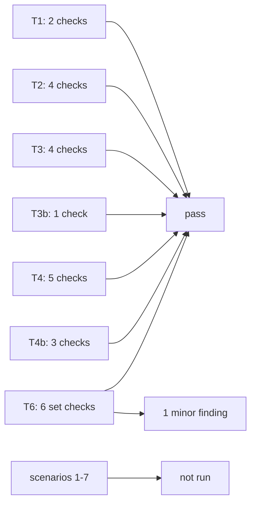

# T6 verification report

Verifier: opencode worker (task_9aa19862894f, run_7e04be770e5c).
Date: 2026-10-13.
Scope: outputs of T1, T2, T3, T3b, T4, T4b. No file was edited except this report.

## Result table

Result values: pass, fail, not run. Evidence paths are relative to `/Users/user/.agents`.

| # | Check | Command | Result | Evidence path |
|---|---|---|---|---|
| 1 | T1: eleven section headings exist in order | `grep -n '^## ' skills/ui-loop-core/SKILL.md` | pass | skills/ui-loop-core/SKILL.md |
| 2 | T1: core ≤1,200 words, 0 sentences over 25 words, 0 missing links | `node skills/ui-loop-core/scripts/check-skill-text.mjs skills/ui-loop-core/SKILL.md` | pass (1,082 words, exit 0) | skills/ui-loop-core/scripts/check-skill-text.mjs |
| 3 | T2: `量表追蹤` count is 0 in each of the four files | `grep -c '量表追蹤' skills/ui-{fix,verify,logic}-loop/SKILL.md skills/ui-loop-core/SKILL.md` | pass (0, 0, 0, 0) | skills/ui-loop-core/SKILL.md |
| 4 | T2: "Herdr session" appears only in core | `grep -l 'Herdr session' skills/ui-*/SKILL.md` | pass (core only) | skills/ui-loop-core/SKILL.md |
| 5 | T2: port `8791` count is 0 in ui-fix-loop | `grep -c 8791 skills/ui-fix-loop/SKILL.md` | pass (0) | skills/ui-fix-loop/SKILL.md |
| 6 | T2: each loop ≤700 words, 0 long sentences, 0 missing links | `node skills/ui-loop-core/scripts/check-skill-text.mjs <each loop SKILL.md>` | pass (694, 582, 691 words, exit 0 each) | skills/ui-fix-loop/SKILL.md |
| 7 | T3: canvas-server.md has Source line, graph, verbatim lines | `node /tmp/t3-source-check.mjs` | pass (11 of 11 lines in backup) | skills/ui-loop-core/references/canvas-server.md |
| 8 | T3: conductor.md has Source line, graph, verbatim lines | `node /tmp/t3-source-check.mjs` | pass (5 of 5 lines in backup) | skills/ui-loop-core/references/conductor.md |
| 9 | T3: executor-triage.md has Source line, graph, verbatim lines | `node /tmp/t3-source-check.mjs` | pass (6 of 6 lines in backup) | skills/ui-loop-core/references/executor-triage.md |
| 10 | T3: whiteboard.md has Source line, graph, verbatim lines | `node /tmp/t3-source-check.mjs` | pass (8 of 9 lines in backup; 1 line is the T3b change) | skills/ui-loop-core/references/whiteboard.md |
| 11 | T3b: single-line label change, rest unchanged | `grep -c 'e2e-verified' whiteboard.md`; `grep -c 'FIXED' whiteboard.md`; line swap-back comparison against backup | pass (0, 0; changed line swaps back to the backup line exactly) | skills/ui-loop-core/references/whiteboard.md |
| 12 | T4: schema validates the review §6 example with the two new fields | `node /tmp/t6-schema-check.mjs skills/ui-loop-core/scripts/fixtures/good.json` | pass (VALID, exit 0) | skills/ui-loop-core/references/evidence.schema.json |
| 13 | T4: check-evidence passes the good fixture | `node skills/ui-loop-core/scripts/check-evidence.mjs skills/ui-loop-core/scripts/fixtures/good.json` | pass (`PASS: 1 issues.`, exit 0) | skills/ui-loop-core/scripts/fixtures/good.json |
| 14 | T4: check-evidence fails the missing-deployed-result fixture | `node skills/ui-loop-core/scripts/check-evidence.mjs skills/ui-loop-core/scripts/fixtures/missing-deployed-result.json` | pass (`Issue 1: Set deployed.result to pass.`, exit 1) | skills/ui-loop-core/scripts/fixtures/missing-deployed-result.json |
| 15 | T4: check-evidence fails the SHA-mismatch fixture | `node skills/ui-loop-core/scripts/check-evidence.mjs skills/ui-loop-core/scripts/fixtures/sha-mismatch.json` | pass (`Issue 1: Include pr.mergeSha in deployed.buildSha.`, exit 1) | skills/ui-loop-core/scripts/fixtures/sha-mismatch.json |
| 16 | T4: walkthrough template prints usage | `node skills/ui-loop-core/scripts/walkthrough.template.mjs --help` | pass (usage printed, exit 0) | skills/ui-loop-core/scripts/walkthrough.template.mjs |
| 17 | T4b: valid cross-skill fixture reports 0 missing targets | `node skills/ui-loop-core/scripts/fixtures/cross-skill-links.test.mjs` | pass (exit 0) | skills/ui-loop-core/scripts/fixtures/cross-skill-links.test.mjs |
| 18 | T4b: bad fixture reports 2 missing targets and exits 1 | same test file, case 3 | pass (exit 0) | skills/ui-loop-core/scripts/fixtures/cross-skill-links.test.mjs |
| 19 | T4b: good and bad text fixtures keep their old results | same test file, case 4 | pass (exit 0) | skills/ui-loop-core/scripts/fixtures/cross-skill-links.test.mjs |
| 20 | T6: check-skill-text exits 0 on all four SKILL.md files | `node skills/ui-loop-core/scripts/check-skill-text.mjs <each of the four>` | pass (exit 0 each) | skills/ui-loop-core/scripts/check-skill-text.mjs |
| 21 | T6: cross-skill-links fixture test exits 0 | `node skills/ui-loop-core/scripts/fixtures/cross-skill-links.test.mjs` | pass (4 cases, exit 0) | skills/ui-loop-core/scripts/fixtures/cross-skill-links.test.mjs |
| 22 | T6: every `Apply ui-loop-core §<Heading>` link names a real heading | `grep -n '§' skills/ui-*/SKILL.md` plus the checker resolution | pass (11 distinct headings, all in core) | skills/ui-loop-core/SKILL.md |
| 23 | T6 set read: no rule stated differently in two files | manual read of the four skills as a set | pass | skills/ui-loop-core/SKILL.md |
| 24 | T6 set read: no label outside `ui-loop-core` §State machine and labels | `grep -n -E '(IMPLEMENTED\|VERIFIED\|BLOCKED) —' skills/ui-*/SKILL.md`; `grep -n FIXED skills/ui-*/SKILL.md` | pass (only the 3 canonical labels; FIXED absent) | skills/ui-loop-core/SKILL.md |
| 25 | T6 set read: instructions point to existing sections | manual read plus `grep -n '§'` sweep | pass with 1 minor finding (see Findings) | skills/ui-loop-core/references/executor-triage.md |
| 26 | Scenario 1: "approved" with question ② unanswered → agent lists ② and waits | — | not run (fresh-session limit, see below) | — |
| 27 | Scenario 2: admin-only target element → BLOCKED before code | — | not run (fresh-session limit) | — |
| 28 | Scenario 3: deployed build SHA without the merge commit → no VERIFIED | — | not run (fresh-session limit) | — |
| 29 | Scenario 4: T0 label change → no canvas, still checks and one live look | — | not run (fresh-session limit) | — |
| 30 | Scenario 5: fix-only round, element behind two clicks → walkthrough written | — | not run (fresh-session limit) | — |
| 31 | Scenario 6: round close → one memory note and one skill delta proposed, neither saved | — | not run (fresh-session limit) | — |
| 32 | Scenario 7 (T6 addition): deployed build SHA without the merge commit → no VERIFIED | — | not run (fresh-session limit; same stimulus as scenario 3) | — |

## Scenario limitation

This worker runs inside the coordinator's opencode session with every skill loaded.
It cannot start an isolated fresh agent session that loads only the four new skills.
Per the T6 update, the coordinator runs the behavior scenarios separately.
No scenario was marked pass from reading the text.

## Findings

1. Minor. `skills/ui-loop-core/references/executor-triage.md` line 18 says "the global selection contract above".
   The contract moved to `ui-loop-core` §Dispatch, so "above" has no target inside the reference file.
   The rule itself is intact in core. Suggest the owner change the pointer to "`ui-loop-core` §Dispatch".
   This is a report only. No file was changed.

No other conflicts found. Checked specifically:

- The approval-time deploy question ban (core §Approval rules item 3) and the deploy-phase question (verify Phase 2 step 1, logic Phase 4 step 1) apply to different phases. Consistent.
- "Phase 0 step 3 applies" in ui-verify-loop names an existing step (Phase 0 step 3, the element-access gate).
- "Phase 1 step 4 applies" in ui-logic-loop names an existing step (Phase 1 step 4, the element-access gate).
- "Apply `ui-fix-loop` Phase 3" in ui-verify-loop names an existing heading (`## Phase 3 — IMPLEMENT, then VERIFY`).
- whiteboard.md §Mode B and §Schema notes pointers exist in `skills/whiteboard-agent-review/SKILL.md` (lines 132 and 204).
- The core element-access example path is byte-identical with the 12:55 backup text.
- Core holds no port, host name, token path, or launchd label (`grep -E '8791|8798|tailscale|launchd|com.kxxwxxg|dashboard-token|mk1a3zpmacbook|tail490654'` = none).
- Machine facts are present in `references/canvas-server.md` and `references/conductor.md`.

## Baseline drift note

Current SHA-256 of each baselined file differs from `baseline.sha256`. This is expected.
The diffs are the sanctioned writes: T2 (three loops), T4b (check-skill-text.mjs), T3b (whiteboard.md).
T6-report.md has no baseline entry. It is a new file.

## Recorded outputs

T1/T2 text checks:

```text
ui-loop-core/SKILL.md: 1082 words   EXIT=0
ui-fix-loop/SKILL.md: 694 words     EXIT=0
ui-verify-loop/SKILL.md: 582 words  EXIT=0
ui-logic-loop/SKILL.md: 691 words   EXIT=0
```

T1 headings (all eleven, in order):

```text
25:## Glossary
37:## Size tiers T0–T2
47:## State machine and labels
67:## Approval rules
82:## Element-access gate
103:## Dispatch
116:## Worktree and PR
127:## Environment pin and build check
138:## Evidence record
150:## Close-out
160:## Edit safety
```

T2 greps:

```text
量表追蹤 counts: ui-fix-loop 0, ui-verify-loop 0, ui-logic-loop 0, ui-loop-core 0
grep -l 'Herdr session' skills/ui-*/SKILL.md -> ui-loop-core/SKILL.md only
8791 counts: 0 in each of the four files
```

T3 source-line check (custom checker, lines compared with `grep -F` semantics against the backup):

```text
canvas-server.md:    11 content lines, 0 missing from backup
conductor.md:         5 content lines, 0 missing from backup
executor-triage.md:   6 content lines, 0 missing from backup
whiteboard.md:        9 content lines, 1 missing from backup (the T3b label line)
```

T3b swap-back check:

```text
grep -c 'e2e-verified' whiteboard.md -> 0
grep -c 'FIXED' whiteboard.md -> 0
current line contains the new core-label sentence: True
current line with the old sentence swapped back equals the backup line: True
```

T4 script runs:

```text
check-evidence.mjs fixtures/good.json                   -> PASS: 1 issues. (exit 0)
check-evidence.mjs fixtures/missing-deployed-result.json -> Issue 1: Set deployed.result to pass. (exit 1)
check-evidence.mjs fixtures/sha-mismatch.json            -> Issue 1: Include pr.mergeSha in deployed.buildSha. (exit 1)
check-evidence.mjs fixtures/implemented.json             -> exit 1 (consistent with the close rule)
walkthrough.template.mjs --help                          -> 5 usage lines, exit 0
t6-schema-check on fixtures/good.json                    -> VALID incl. walkthrough.driver and walkthrough.profileOrAccount (exit 0)
```

T4b / T6 fixture test:

```text
node fixtures/cross-skill-links.test.mjs
Pass: valid cross-skill and local links.
Pass: cross-skill links from a nested file.
Pass: two missing cross-skill targets, despite a matching local heading.
Pass: unchanged good and bad text fixture results.
exit 0
```

Note on T4 acceptance item 3: it expected `check-skill-text.mjs` to print findings on the loop files (exit 1) before T2.
T2 has since thinned the loops. The T6 update supersedes: exit 0 for each of the four files. Observed: exit 0 each.
