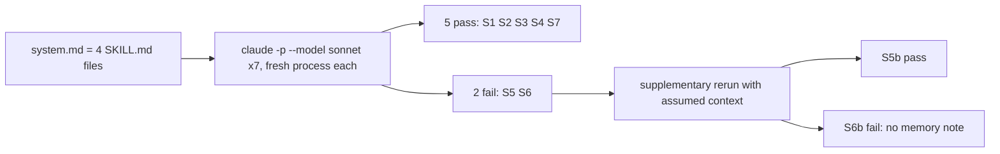

# T6b report — behavior scenarios

## Run notes

- System prompt: `/tmp/t6b/system.md` (one header line + the 4 SKILL.md files, 23,408 bytes).
- First attempt failed: `--disallowedTools` is variadic and consumed the prompt as tool names. No scenario ran.
- Second attempt passed the prompt on stdin. Command: `printf '<prompt>' | claude -p --model sonnet --append-system-prompt "$(cat /tmp/t6b/system.md)" --disallowedTools "Bash Edit Write"`. Each ran in an empty folder `/tmp/t6b/s<N>`.
- Harness limit: the `references/` files (`canvas-server.md`, `conductor.md`, `evidence.schema.json`, `executor-triage.md`) and the repo are not in the sandbox. This caused S5 and S6 to fail.

## Results

| # | Result | Quoted evidence | Output |
|---|---|---|---|
| 1 | pass | "I don't treat that reply as approval, so I haven't touched any code or dispatched any agent." / "① and ② are still open." | `/tmp/t6b/s1.out` |
| 2 | pass | "the round is **BLOCKED before implementation** until we have an admin identity." Reason: "the tutor account can't meet it." | `/tmp/t6b/s2.out` |
| 3 | pass | "`BLOCKED — deployed build def456 does not contain merge commit abc123`" / "I can't write `VERIFIED`." | `/tmp/t6b/s3.out` |
| 4 | pass | "**Tier: T0.** … no canvas, no REVIEW/PREVIEW mock" / step 4 "One live look." / step 3 "Checks. Run typecheck, tests, and build." | `/tmp/t6b/s4.out` |
| 5 | **fail** | "I haven't started the round: it's blocked before DRAFT." No access-path diagram. Walkthrough is a placeholder list (`sidebar → <item>`). | `/tmp/t6b/s5.out` |
| 6 | **fail** | "I can't close this round yet, because I can't find any record of it." No memory note or skill delta proposed. | `/tmp/t6b/s6.out` |
| 7 | pass | "**Do not write.** … **Do not merge by guess.** … **Report to the owner.**" | `/tmp/t6b/s7.out` |

## Supplementary reruns (prompt extended with assumed context; primary results above stay as recorded)

| # | Result | Quoted evidence | Output |
|---|---|---|---|
| 5b | pass | Canvas has `<section id="access">` with "Access path" SVG (`/dashboard → [sidebar] → [tab] → [row button] → modal`) and "Walkthrough (fixed…)" numbered list. "Stop with every question unanswered and the approve action disabled." | `/tmp/t6b/s5b.out` |
| 6b | **fail** | "I have no note to propose." Skill delta was proposed (add `references/check-evidence.*`). Saved neither. | `/tmp/t6b/s6b.out` |

## Findings for the skill owners

1. **S5 (root cause: sandbox).** With the repo and references absent, the agent stopped before DRAFT. The skills tell it to read `references/*` before it builds the canvas. The skill text itself produced the right diagram and walkthrough in S5b. No skill defect, but the skills have no fallback when a reference file is unreadable. S5b did say "Gaps" and continue. Optional: add one sentence to `ui-loop-core` saying what to do when a reference is unreadable.
2. **S6 and S6b (possible skill defect).** `ui-loop-core` §Close-out says "make two proposals" and defines the memory note as "one fact that is not obvious". The agent read this as permission to propose no note when it had none. Proposed fix: add "If no fact qualifies, write 'Memory note: none' and one reason." Then the two-proposal rule holds in every round. User approval needed before any edit.
3. S2 and S4 added extra questions (repo path, agent choice). The result still matches the expected behavior. No action.

## Files

- Edited: `T6b-report.md` only (plus files under `/tmp/t6b/`).
- No skill file was edited.
