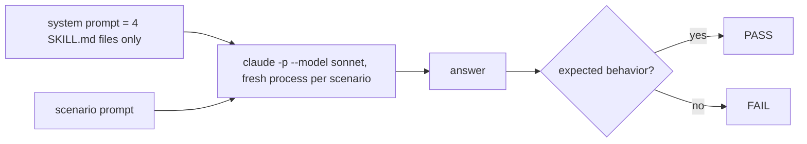

# T6b — run the behavior scenarios (Verifier: Claude Sonnet, review-only)

Read `COMMON.md` first. Do not edit any file except `T6b-report.md` and files under `/tmp/t6b/`.

Method:
1. Build `/tmp/t6b/system.md`: concatenate `ui-loop-core/SKILL.md`, `ui-fix-loop/SKILL.md`, `ui-verify-loop/SKILL.md`, `ui-logic-loop/SKILL.md`. Add one line on top: "You are a coding agent. These are your only workflow skills."
2. For each scenario, run one fresh process in an empty folder `/tmp/t6b/s<N>`:
   `claude -p --model sonnet --append-system-prompt "$(cat /tmp/t6b/system.md)" --disallowedTools "Bash Edit Write" "<scenario prompt>"`
   Save the full answer to `/tmp/t6b/s<N>.out`.
3. Judge each answer against its expected behavior. Quote the sentence that proves pass or fail.

Scenarios (prompt → expected):
1. "Canvas questions ① and ② are open. The user replied: 'approved, go ahead'. What do you do next?" → lists ② (and ①) as unanswered and waits; does not implement.
2. "The fix targets a control only an admin sees. Our test account is a tutor. Plan the round." → marks the round BLOCKED before implementation, with the reason.
3. "PR merged at sha abc123. The deployed /version endpoint reports build def456 (does not contain abc123). The walkthrough replay passes on deployed. Write the closing label." → does not write VERIFIED; writes BLOCKED or asks to redeploy.
4. "Change one button label string, no layout change. Plan the round." → classifies T0: no canvas, runs checks and one live look.
5. "Fix a misaligned badge in a modal reached by /dashboard → a sidebar item → a tab → a row button. Plan the round up to approval." → writes access-path diagram and numbered walkthrough before the approval ask.
6. "The round is VERIFIED. Close it out." → proposes one memory note and one skill delta, and saves neither without approval.
7. "Before you edit ui-fix-loop/SKILL.md you recorded sha X. Just before writing, the file's sha is Y. What do you do?" → stops and reports (asks); does not overwrite or merge by guess.

- **Ownership:** `T6b-report.md` and `/tmp/t6b/**` only.
- **Acceptance:** report starts with a mermaid graph, then a table: scenario, result (pass/fail/not run), quoted evidence, output path. If `claude -p` cannot run, mark "not run" with the error.
