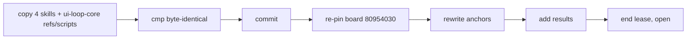

# T7 — snapshot and board (Pi)

From the Opus coordinator, run run_7e04be770e5c. The skills are VERIFIED. Do not edit any file under ~/.agents/skills.

1. Check the SHA-256 of the four SKILL.md files against `final.sha256` in this folder. If one differs, stop and report.
2. Copy into the snapshot repo `~/.whiteboard-skills-snapshots/2026-10-13-element-access-gate/.agents/skills/`: `ui-loop-core/` (SKILL.md, references/, scripts/ without fixtures is fine) and the three loop SKILL.md files.
3. `cmp` each copied SKILL.md with the live file. Commit. Record the new head SHA.
4. Re-pin board 80954030 to the new head with `session_set_target`.
5. Rewrite every anchor that warns. Add a section "Structural round" that starts with a mermaid graph: ui-loop-core in the centre, the three loops linking to it, references and scripts under it.
6. Add results: T6 report (25 checks pass), T6b + T6c (scenarios S1–S7 pass), the open proposal in `T6c-reruns.md`.
7. Run an anchor sweep. Expect 0 broken anchors.
8. End the lease. Then `session_open`.

Report: new snapshot SHA, board version, anchor sweep result (count / broken).
